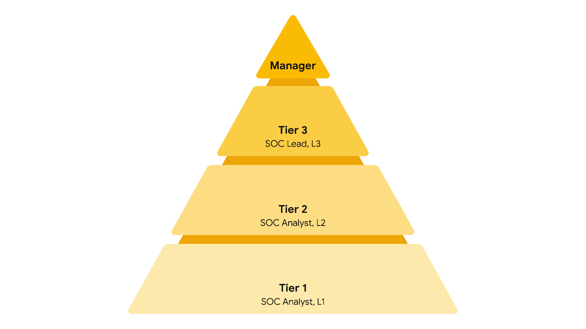

# CSIRT and SOC: Roles and Responsibilities

## Recap: NIST incident response lifecycle

1. Preparation
2. Detection and analysis
3. Containment, eradication, and recovery
4. Post-incident activity

Knowing how response teams are organized helps you collaborate, communicate, and work cohesively during an incident.

---

## Command, control, and communication

Effective incident response needs all three:

| Term | Meaning |
|------|---------|
| **Command** | Leadership and direction to oversee the response |
| **Control** | Managing technical aspects, like coordinating resources and assigning tasks |
| **Communication** | Keeping stakeholders informed |

---

## CSIRT (Computer Security Incident Response Team)

A specialized group of security professionals trained in incident management and response.

- Structure varies by organization: a **dedicated team** or a **task force** that meets when needed
- Includes both **security** and **nonsecurity** professionals
- Nonsecurity input comes from departments like HR, public relations, management, IT, and legal

### Key security roles

| Role | Responsibilities |
|------|-----------------|
| **Security analyst** | Continuously monitors for threats; analyzes and triages alerts; performs root-cause investigations; escalates or resolves alerts (critical threats go to the technical lead) |
| **Technical lead** | Manages all technical aspects (e.g. patches and updates); determines root cause; creates and implements strategies for containment, eradication, and recovery; aligns response priorities with business priorities |
| **Incident coordinator** | Coordinates with relevant departments; keeps communication lines open and clear; keeps everyone aware of incident status; also found in other teams, like the SOC |

**Other roles** (depending on the organization): communications lead, legal lead, planning lead, and more.

> Titles differ between companies. Incident coordinator may also be called **incident commander** or **incident manager**.

---

## SOC (Security Operations Center)

An organizational unit dedicated to monitoring networks, systems, and devices for security threats or attacks.

- Pronounced "sock"
- Can be a separate unit or part of a CSIRT
- Involved in **blue team** activities: network monitoring, analysis, and incident response
- **Blue team:** security professionals who defend against all security threats and attacks

### SOC hierarchy

| Tier | Role | Responsibilities |
|------|------|-----------------|
| **L1** | SOC analyst (least experienced) | Monitor, review, and prioritize alerts by criticality or severity; create and close alerts in ticketing systems; escalate tickets to Tier 2 or 3 |
| **L2** | SOC analyst (more experienced) | Receive escalated tickets and investigate more deeply; configure and refine security tools; report to the SOC lead |
| **L3** | SOC lead (highly experienced) | Manage team operations; explore detection methods with advanced techniques (malware and forensics analysis); report to the SOC manager |
| **Top** | SOC manager | Hire, train, and evaluate team members; create performance metrics and manage performance; develop incident, compliance, and auditing reports; communicate findings to stakeholders such as executives |

### Other specialized SOC roles

| Role | Description |
|------|-------------|
| **Forensic investigator** | Usually L2s and L3s; collect, preserve, and analyze digital evidence to determine what happened |
| **Threat hunter** | Typically L3s; detect, analyze, and defend against new and advanced threats using threat intelligence |

> Like CSIRTs, SOC structure varies by organization.

---

## Key takeaways

- Understanding team structure shows how incidents move through the lifecycle and who is responsible at each point
- You'll work with your own team and with people outside it
- Knowing your role and others' roles helps you handle difficult situations using different perspectives

---

## Quick recall

- **CSIRT security roles:** security analyst, technical lead, incident coordinator
- **SOC tiers:** L1 analyst, L2 analyst, L3 lead, then manager
- **Escalation path:** L1 to L2 to L3 (analysts in a CSIRT escalate to the technical lead)
- **Command / control / communication:** leadership, technical management, keeping stakeholders informed
- **Blue team:** the defenders

---

## Resources for more Information

Here are some resources if you’d like to learn more about SOC organization or explore other incident response roles:

- [The security operations ecosystem](https://chronicle.security/blog/posts/soc-ecosystem-infographic/)
- [Cyber career pathways tool](https://niccs.cisa.gov/workforce-development/cyber-career-pathways-tool)
- [Detection and Response](https://www.youtube.com/watch?v=QZ0cpBocl3c)
 at Google: Episode 2 of the [Hacking Google](https://www.youtube.com/playlist?list=PL590L5WQmH8dsxxz7ooJAgmijwOz0lh2H)
 series of videos
