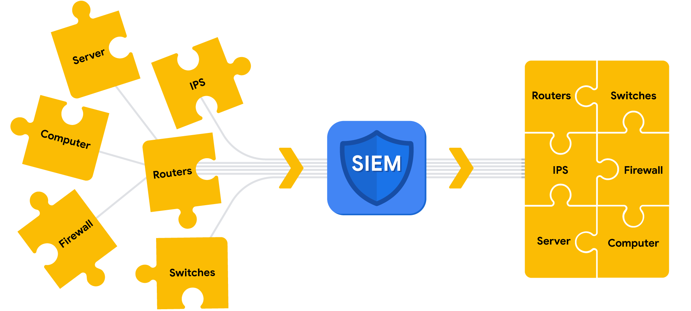

# Security Information and Event Management (SIEM)

## 1. What is SIEM?
- **SIEM:** Security Information and Event Management.
- It is an application that collects and analyzes log data to monitor important activities in an organization.
- **Log analysis:** Examining logs to identify events of interest.
- SIEM helps security analysts detect threats, investigate incidents, and respond to attacks.

## 2. Advantages of SIEM

1. **Access to Event Data**
   - Collects data from multiple devices and systems.
   - Provides access to real-time network activity.

2. **Monitoring, Detecting, and Alerting**
   - Continuously monitors systems and networks.
   - Uses detection rules to identify suspicious activity.
   - Generates alerts when activity matches a rule.

3. **Log Storage**
   - Stores logs for future investigations.
   - Maintains historical data according to organizational requirements.

## 3. SIEM Process

The SIEM process consists of three main steps:

1. Collect and aggregate data.
2. Normalize data.
3. Analyze data.

### Step 1: Collect and Aggregate Data
- SIEM collects logs from sources such as firewalls, servers, and routers.
- **Logs:** Records of events that occur within an organization's systems.
- Logs may contain timestamps, IP addresses, usernames, and other event details.
- **Aggregation:** Combining log data from different sources into one centralized location.
- It eliminates the need to check each device separately.

**Parsing:**
- Parsing extracts fields and their corresponding values from raw logs.
- It makes log data easier to read and understand.

Example:

Raw log:
`April 3 11:01:21 server sshd[1088]: Failed password for user nuhara from 218.124.14.105 port 5023`

Parsed fields:
- Host = server
- Process = sshd
- Source user = nuhara
- Source IP = 218.124.14.105
- Source port = 5023

### Step 2: Normalize Data
- Different sources may produce logs in different formats.
- **Normalization:** Converting collected data into a standard, structured format.
- Makes data easier to search, compare, and analyze.
- Helps SIEM process logs from different systems consistently.

### Step 3: Analyze Data
- SIEM analyzes collected, aggregated, and normalized logs.
- Uses detection rules and conditions to identify suspicious activities.
- Generates alerts when log activity matches a detection rule.

**Correlation:**
- Compares multiple log events to identify common patterns.
- Helps identify potential security threats that may not be obvious from a single event.

## 4. Common SIEM Tools
- AlienVault OSSIM
- Chronicle
- Elastic
- Exabeam
- IBM QRadar
- LogRhythm
- Splunk

## 5. Key Takeaways
- SIEM provides centralized collection, storage, and analysis of security logs.
- Parsing extracts fields and values from raw logs.
- Aggregation combines logs from different sources in one location.
- Normalization converts logs into a standard format.
- Analysis applies detection rules to identify suspicious activity.
- Correlation compares multiple events to detect potential threats.
- SIEM helps security teams investigate incidents and improve an organization's security posture.