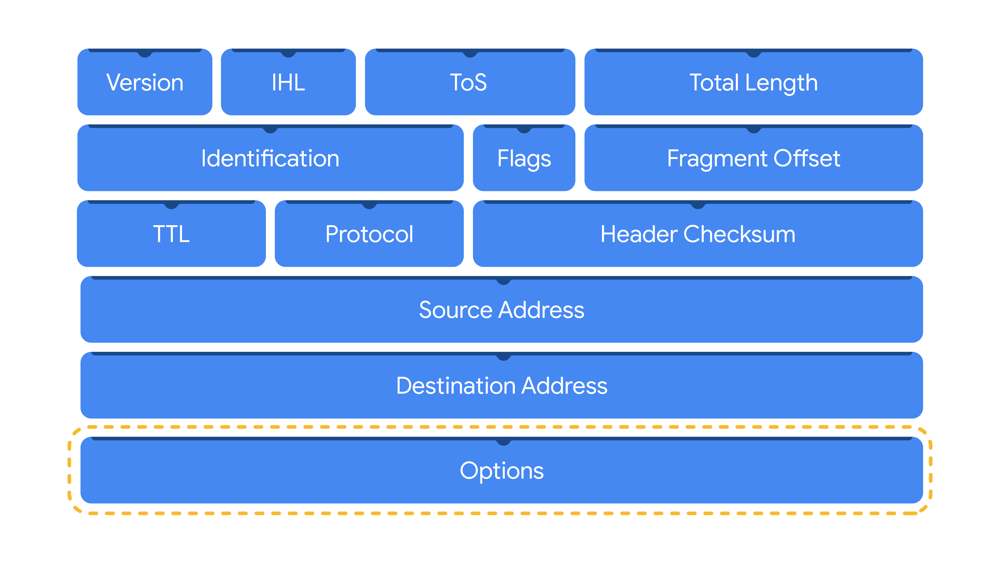

# Network Analysis: Packets, Protocol Analyzers, and Packet Captures

## 1. Network Analysis
- Network analysis involves monitoring and examining network traffic to identify unusual activity and potential intrusions.
- Security analysts analyze packets to understand network communications and detect threats.

## 2. Data Packets
- **Data packet:** The basic unit of information transmitted between devices over a network.
- Data is divided into packets, transmitted to the destination, and reassembled.
- Packets help analysts investigate network activity and identify abnormalities.

### Components of a Packet

1. **Header**
   - Contains routing and control information.
   - Includes source and destination IP addresses, packet length, protocol, and identification information.
   - May contain multiple headers, such as Ethernet, IP, and TCP headers.

>Here is an IPv4 header with the information it provides:

2. **Payload**
   - Contains the actual data being transmitted.
   - Example: The image data being uploaded to a website.

3. **Footer (Trailer)**
   - Located at the end of a packet.
   - Ethernet uses a footer for error checking to detect corrupted data.
   - Most protocols, including IP, do not use footers.

## 3. Network Protocol Analyzers
- **Definition:** Tools that capture and analyze network traffic.
- Also known as **packet sniffers**.
- They display captured data in a human-readable format.

### Uses
- Detect suspicious network activity.
- Investigate security incidents.
- Collect network statistics, such as bandwidth and speed.
- Troubleshoot network performance problems.
- Malicious actors can misuse them to capture sensitive information, such as login credentials.

### Examples
- Wireshark
- tcpdump
- TShark

## 4. How Network Protocol Analyzers Work

1. **Packet Collection**
   - The Network Interface Card (NIC) receives and transmits network traffic.
   - By default, a NIC generally processes traffic addressed to it.
   - Special modes allow it to capture other visible traffic.

2. **Traffic Capture**
   - The analyzer collects packets in raw binary format (0s and 1s).
   - The NIC and analyzer must have access to the relevant network traffic.

3. **Data Conversion**
   - The analyzer converts packet data into a human-readable format.
   - Security analysts examine the information to identify suspicious activity.

### Special NIC Modes
- **Promiscuous mode:** Allows a wired network interface to capture visible packets beyond those addressed to the device.
- **Monitor mode:** Allows a wireless interface to capture visible wireless traffic, including frames not addressed to the device.

Note: These modes do not provide access to all traffic across an entire network. The analyzer must be positioned appropriately to capture the required traffic.

## 5. Packet Sniffing and Packet Captures
- **Packet sniffing:** The practice of capturing and inspecting network packets.
- **Packet capture (P-cap):** A file containing captured packets from a network interface or network.
- Packet captures can be opened and analyzed using network protocol analyzers.
- Filters help analysts focus on relevant traffic, such as packets from a specific IP address.

**Security note:** Capturing private network communications without permission may be illegal. Promiscuous mode can also expose sensitive information, so these tools must be used responsibly.

## 6. Packet Capture Libraries and Formats

1. **Libpcap**
   - A packet capture library used by Unix-like systems, including Linux and macOS.
   - Used by tools such as tcpdump.

2. **WinPcap**
   - An older packet capture library designed for Windows.
   - It is no longer commonly used.

3. **Npcap**
   - A packet capture library commonly used on Windows.
   - Developed by the Nmap project.

4. **PCAPng**
   - Stands for Packet Capture Next Generation.
   - A modern format that supports packet capture and stores additional metadata.

## 7. Key Takeaways
- Packets consist of a header, payload, and sometimes a footer.
- Network protocol analyzers capture and analyze network traffic.
- NICs provide access to network packets.
- Promiscuous mode is commonly associated with wired capture, while monitor mode is used for wireless capture.
- Packet sniffing means capturing and inspecting packets.
- Packet captures store captured traffic for further investigation.
- Wireshark, tcpdump, and TShark are common network analysis tools.
- Libpcap, WinPcap, Npcap, and PCAPng are associated with packet capture.

## 8. Resources for more information
- This Infosec article describes the risks of [packet crafting](https://www.infosecinstitute.com/resources/hacking/packet-crafting-a-serious-crime/)
, a technique used to test a network’s structure.