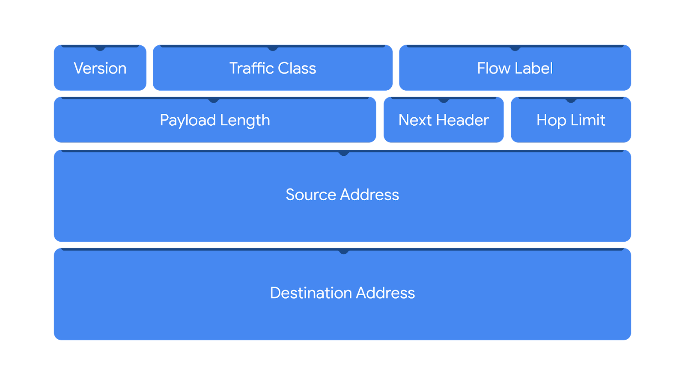
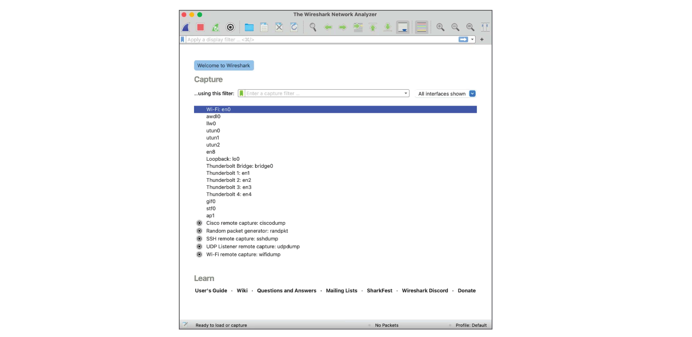
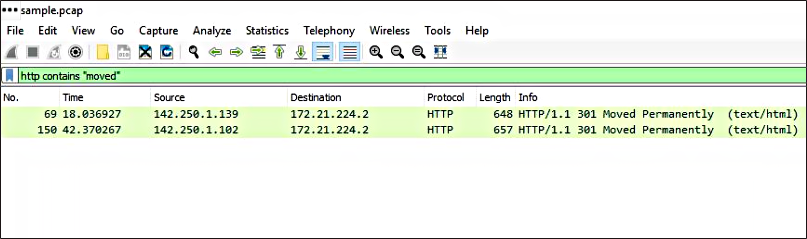
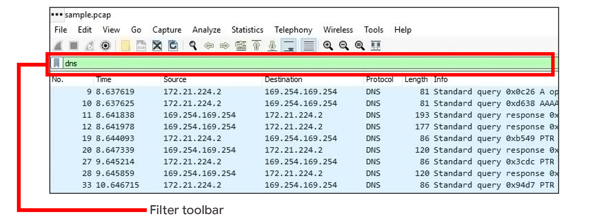
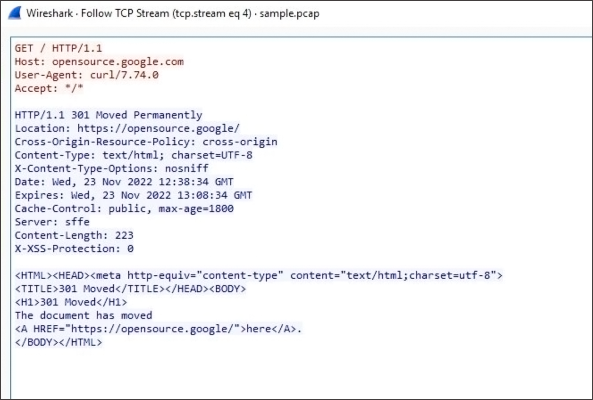

# IP Headers and Wireshark Packet Analysis

## 1. Internet Protocol (IP)
- **IP:** A set of standards used for addressing and routing packets between devices.
- Ensures packets can travel to their intended destinations.
- Two versions: IPv4 and IPv6.

## 2. IPv4 Header
IPv4 is the most commonly used IP version. Its header contains 13 fields.

1. **Version:** Identifies the IP version.
2. **Internet Header Length (IHL):** Specifies the IPv4 header length, including options.
3. **Type of Service (ToS):** Indicates packet priority and delivery requirements.
4. **Total Length:** Specifies the total size of the IP packet, including header and data.
5. **Identification:** Identifies fragments belonging to the same original packet.
6. **Flags:** Provides information about packet fragmentation.
7. **Fragment Offset:** Indicates the position of a fragment within the original packet.
8. **Time to Live (TTL):** Limits how long a packet can travel through a network before being discarded.
9. **Protocol:** Identifies the protocol carried in the data portion, such as TCP or UDP.
10. **Header Checksum:** Checks the IPv4 header for errors.
11. **Source Address:** IP address of the sender.
12. **Destination Address:** IP address of the receiver.
13. **Options:** Optional field used for additional packet information.

## 3. IPv6 Header
IPv6 provides a much larger address space than IPv4. Its basic header contains 8 fields.

1. **Version:** Identifies the IP version.
2. **Traffic Class:** Indicates packet priority or traffic class.
3. **Flow Label:** Identifies packets belonging to the same flow.
4. **Payload Length:** Specifies the length of the data following the IPv6 header, including extension headers if present.
5. **Next Header:** Identifies the next header, such as TCP, UDP, or an IPv6 extension header.
6. **Hop Limit:** Limits the number of hops a packet can travel before being discarded.
7. **Source Address:** IP address of the sender.
8. **Destination Address:** IP address of the receiver.

**Important differences:**
- IPv4 uses **TTL**, while IPv6 uses **Hop Limit**.
- IPv4 uses **Protocol**, while IPv6 uses **Next Header**.
- IPv4 has a header checksum; IPv6 does not.
- IPv4 addresses are 32 bits, while IPv6 addresses are 128 bits.

## 4. Wireshark
- **Definition:** An open-source network protocol analyzer with a graphical user interface (GUI).
- Used to capture, inspect, and analyze network traffic.
- Displays packet information in a human-readable format.
- Helps security analysts investigate suspicious network activity.

## 5. Display Filters
- Display filters show only packets matching specified conditions.
- Useful when analyzing packet captures containing large amounts of traffic.
- Filters can be based on protocols, IP addresses, MAC addresses, ports, and other packet fields.

### Comparison Operators

| Operation | Symbol | Abbreviation |
|---|---|---|
| Equal | `==` | `eq` |
| Not equal | `!=` | `ne` |
| Greater than | `>` | `gt` |
| Less than | `<` | `lt` |
| Greater than or equal to | `>=` | `ge` |
| Less than or equal to | `<=` | `le` |

- **AND:** Both conditions must be true.
- **OR:** At least one condition must be true.
- Parentheses can group conditions.

Example:
`ip.src == 192.168.1.10 and tcp.port == 80`

## 6. Contains and Matches Operators

- **Contains (`contains`):** Filters packets containing a specified string of text.

  - Example: `http contains "moved"`
- **Matches (`matches`):** Filters packets using a regular expression (regex) pattern.
  - Example: `http.host matches ".*example.*"`

## 7. Common Wireshark Display Filters

### Protocol Filters
Enter the protocol name to display related packets.

| Protocol | Filter |
|---|---|
| DNS | `dns` |
| HTTP | `http` |
| FTP | `ftp` |
| SSH | `ssh` |
| ARP | `arp` |
| Telnet | `telnet` |
| ICMP | `icmp` |

### IP Address Filters

- **Any source or destination IP:**
  `ip.addr == 172.21.224.2`

- **Source IP address:**
  `ip.src == 10.10.10.10`

- **Destination IP address:**
  `ip.dst == 4.4.4.4`

### MAC Address Filter
- **MAC address:** A hardware/network interface identifier.
- Filter example:
  `eth.addr == 00:70:f4:23:18:c4`

### Port Filters
- **UDP port 53:**
  `udp.port == 53`
- **TCP port 25:**
  `tcp.port == 25`

Port numbers help isolate traffic associated with particular network services.

## 8. Follow Streams
- A **stream** or **conversation** is an exchange of data between devices using a protocol.
- Wireshark can reassemble packets belonging to a conversation into a readable sequence.
- The Follow Stream feature helps analysts examine requests and responses.
- Example: Following an HTTP stream to inspect exchanged request and response messages.

## 9. Key Takeaways
- IPv4 and IPv6 headers contain information used to route and process packets.
- Wireshark helps analysts inspect packet headers and network communications.
- Display filters isolate relevant packets for investigation.
- Comparison operators, logical operators, `contains`, and `matches` help create specific filters.
- IP, MAC address, protocol, and port filters help identify relevant traffic.
- Follow Stream reconstructs conversations to make exchanged data easier to understand.

## 10. Resources
- To learn more about Wireshark's full features and capabilities, explore the [Wireshark official user guide](https://www.wireshark.org/docs/wsug_html/).