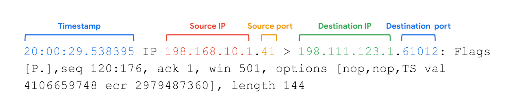

# Tcpdump: Network Packet Capture and Analysis

## 1. What is Tcpdump?
- **Tcpdump:** A command-line network protocol analyzer used to capture and inspect network traffic.
- Works through a **Command-Line Interface (CLI)**.
- Used to troubleshoot network issues and detect suspicious activity.
- Can save captured packets in a **PCAP file** for later analysis.
- Available on Linux and other Unix-based systems like macOS.

**Note:** Encrypted network traffic may require appropriate decryption keys to inspect its contents.

## 2. Capturing Packets with Tcpdump

### Basic Syntax
`sudo tcpdump [-i interface] [options] [expressions]`

- **sudo:** Runs tcpdump with elevated privileges.
- **-i:** Specifies the network interface.
- **Options:** Modify how tcpdump captures or displays packets.
- **Expressions:** Filter traffic based on specific conditions.

### Examples
- `sudo tcpdump -D` - Lists available network interfaces.
- `sudo tcpdump -i any` - Captures traffic from all available interfaces.
- `sudo tcpdump -i eth0` - Captures traffic from the eth0 interface.

**Note:** Capturing packets generally requires administrator privileges or appropriate capture permissions.

## 3. Important Tcpdump Options

| Option | Function |
|---|---|
| `-i` | Selects the network interface |
| `-D` | Lists available network interfaces |
| `-w` | Saves captured packets to a PCAP file |
| `-r` | Reads packets from a PCAP file |
| `-v` | Displays detailed packet information |
| `-vv` | Displays more detailed information |
| `-vvv` | Displays maximum verbosity |
| `-c` | Limits the number of packets captured |
| `-n` | Disables hostname resolution |
| `-nn` | Disables hostname and port name resolution |

### Common Commands

**1. Save packets to a file:**
`sudo tcpdump -i any -w packetcapture.pcap`

**2. Read a saved capture:**
`tcpdump -r packetcapture.pcap`

**3. Read packets with detailed information:**
`tcpdump -r packetcapture.pcap -v`

**4. Capture only 3 packets:**
`sudo tcpdump -i any -c 3`

**5. Disable name resolution:**
`sudo tcpdump -i any -nn`

**6. Combine options:**
`tcpdump -r packetcapture.pcap -vn`

## 4. Name Resolution
- By default, tcpdump may convert IP addresses into hostnames and port numbers into service names.
- **Reverse DNS lookup:** A query that finds the domain name associated with an IP address.
- Name resolution can slow analysis or produce misleading results.
- Reverse DNS queries may also reveal investigative activity.

**Best Practice:**
- Use `-n` to disable hostname resolution.
- Use `-nn` to disable both hostname and port name resolution.

## 5. Tcpdump Filter Expressions
- **Expressions:** Conditions used to capture or display specific network traffic.
- Help isolate packets based on protocols, IP addresses, and ports.

### Common Expressions

| Expression | Function |
|---|---|
| `ip` | Filters IPv4 packets |
| `ip6` | Filters IPv6 packets |
| `tcp` | Filters TCP packets |
| `udp` | Filters UDP packets |
| `icmp` | Filters ICMP packets |
| `host 192.168.1.10` | Filters traffic involving a specific IP |
| `port 80` | Filters traffic using port 80 |
| `src host 192.168.1.10` | Filters packets from a source IP |
| `dst port 443` | Filters packets sent to port 443 |

### Boolean Operators
- **and:** Both conditions must match.
- **or:** At least one condition must match.
- **not:** Excludes packets matching a condition.

### Examples

**1. Filter IPv4 traffic using port 80:**
`sudo tcpdump -i any 'ip and port 80'`

**2. Filter traffic using ports 80 or 443:**
`sudo tcpdump -i any 'port 80 or port 443'`

**3. Filter IPv4 traffic on ports 80 or 443:**
`sudo tcpdump -i any 'ip and (port 80 or port 443)'`

**4. Read a PCAP file with filters:**
`tcpdump -r packetcapture.pcap -n 'ip and port 80'`

**Note:** Quotes help the shell interpret complex filter expressions correctly. Parentheses group conditions.

## 6. Interpreting Tcpdump Output

Example command:
`sudo tcpdump -i any -v -c 1`

Tcpdump generally displays one line per captured packet.

### Important Output Fields

1. **Timestamp:** Time when the packet was captured.
2. **Source IP:** IP address of the sender.
3. **Source Port:** Port number from which the packet originated.
4. **Destination IP:** IP address of the receiver.
5. **Destination Port:** Port number to which the packet is being sent.
6. **TCP Flags:** Indicate connection states or actions, such as SYN, ACK, and FIN.
7. **Sequence Number:** Helps track the order of TCP data.
8. **Options:** Additional packet information, depending on the verbosity level.

### Example Output
`14:30:25.123456 IP 192.168.1.10.54321 > 192.168.1.20.80: Flags [S], seq 1000`

- **14:30:25.123456:** Timestamp
- **192.168.1.10:** Source IP
- **54321:** Source port
- **192.168.1.20:** Destination IP
- **80:** Destination port
- **[S]:** TCP SYN flag (connection request)
- **seq 1000:** TCP sequence number

## 7. Key Takeaways
- Tcpdump is a CLI-based tool for capturing and analyzing network packets.
- `-i` selects an interface, while `-D` lists available interfaces.
- `-w` saves packet captures, and `-r` reads saved files.
- `-v`, `-vv`, and `-vvv` control the level of packet details.
- `-c` limits the number of packets captured.
- `-n` and `-nn` disable automatic name resolution.
- Filter expressions help isolate relevant traffic.
- Boolean operators allow more complex packet filtering.
- Tcpdump output provides timestamps, IP addresses, ports, and protocol details.
- Tcpdump helps security analysts investigate network activity and identify potential threats.

## 8. Resources for more information
- Learn more with tcpdump's [tutorials and guides](https://www.tcpdump.org/), which includes additional educational resources. 
- Learn more about using expressions to filter traffic with this [tcpdump tutorial by Daniel Miessler](https://danielmiessler.com/p/tcpdump/).

