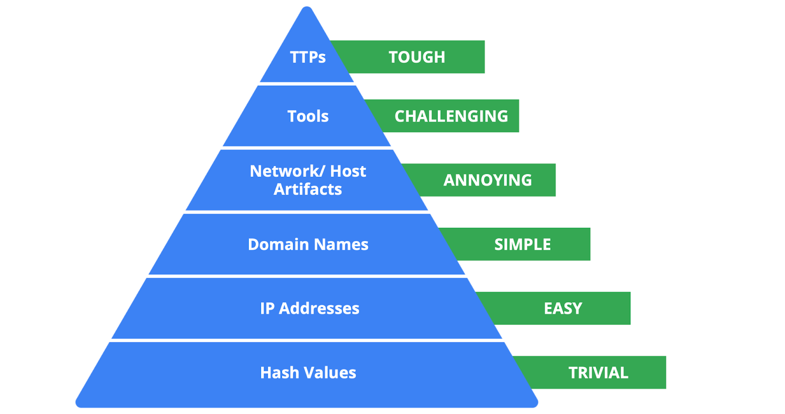

# Indicators of Compromise (IoCs) and Pyramid of Pain

## 1. Indicators of Compromise (IoCs)
- **Definition:** Observable evidence that suggests a potential security incident.
- IoCs are specific pieces of evidence associated with an attack, such as a malicious filename or IP address.
- They generally help identify **what happened and who was involved** after an attack.
- IoCs do not always confirm an attack; they may also result from human error or system malfunctions.

**Examples:**
- Malicious file hashes.
- Suspicious IP addresses.
- Malicious domain names.
- Files created by malware.

## 2. Indicators of Attack (IoAs)
- **Definition:** A series of observed events or behaviors that indicate an ongoing or real-time attack.
- IoAs focus on the attacker's behavior, methods, and intentions.
- They help identify **how and why an attack is happening**.

**Example:** A process unexpectedly making a network connection may indicate suspicious behavior.

- The process's behavior is an IoA.
- Its filename and the IP address it contacted are related IoCs.

## 3. Difference Between IoCs and IoAs

| IoCs | IoAs |
|---|---|
| Focus on evidence associated with an attack. | Focus on attacker behavior. |
| Often identify evidence after an attack. | Help identify ongoing attacks. |
| Help determine what happened and who was involved. | Help understand how and why an attack is occurring. |
| Example: Malicious file hash. | Example: A process performing suspicious network activity. |

## 4. Pyramid of Pain

- Created by security researcher **David J. Bianco**.
- Explains the relationship between types of IoCs and the difficulty attackers face when security teams detect and block them.
- The higher the indicator is on the pyramid, the more difficult it generally becomes for attackers to adapt.
- Blocking indicators at the bottom is relatively easy for attackers to work around, while disrupting indicators at the top causes greater difficulty.

### Seven Levels of the Pyramid of Pain

1. **Hash Values**
   - Unique values used to identify specific files.
   - Example: A hash associated with a known malicious file.
   - Pain level: Trivial.

2. **IP Addresses**
   - Addresses used to identify devices on a network.
   - Example: Blocking an IP address associated with an attacker.
   - Pain level: Easy.

3. **Domain Names**
   - Names used to identify websites or network services.
   - Example: Blocking a malicious domain.
   - Pain level: Simple.

4. **Network Artifacts**
   - Observable evidence of malicious activity in network communications.
   - Example: Suspicious User-Agent strings in network traffic.
   - Pain level: Annoying.

5. **Host Artifacts**
   - Observable evidence of malicious activity on a device.
   - Example: A suspicious filename created by malware.
   - Pain level: Distressing.

6. **Tools**
   - Software used by attackers to achieve their objectives.
   - Example: Password-cracking tools such as John the Ripper.
   - Pain level: Challenging.

7. **Tactics, Techniques, and Procedures (TTPs)**
   - Describe how attackers plan and execute their activities.
   - **Tactics:** The attacker's overall objective.
   - **Techniques:** The methods used to achieve the objective.
   - **Procedures:** The specific steps used to carry out the techniques.
   - Pain level: Tough.

## 5. Key Takeaways
- **IoCs** provide evidence associated with potential security incidents.
- **IoAs** focus on behaviors that indicate an ongoing attack.
- IoCs alone do not always confirm that an attack occurred.
- The Pyramid of Pain has seven levels, from hash values at the bottom to TTPs at the top.
- Blocking hashes and IP addresses is relatively easy for attackers to work around.
- Detecting and disrupting attacker tools and TTPs generally causes greater difficulty for attackers.

## 6. Resource
- David J. Bianco, *The Pyramid of Pain*: http://detect-respond.blogspot.com/2013/03/the-pyramid-of-pain.html