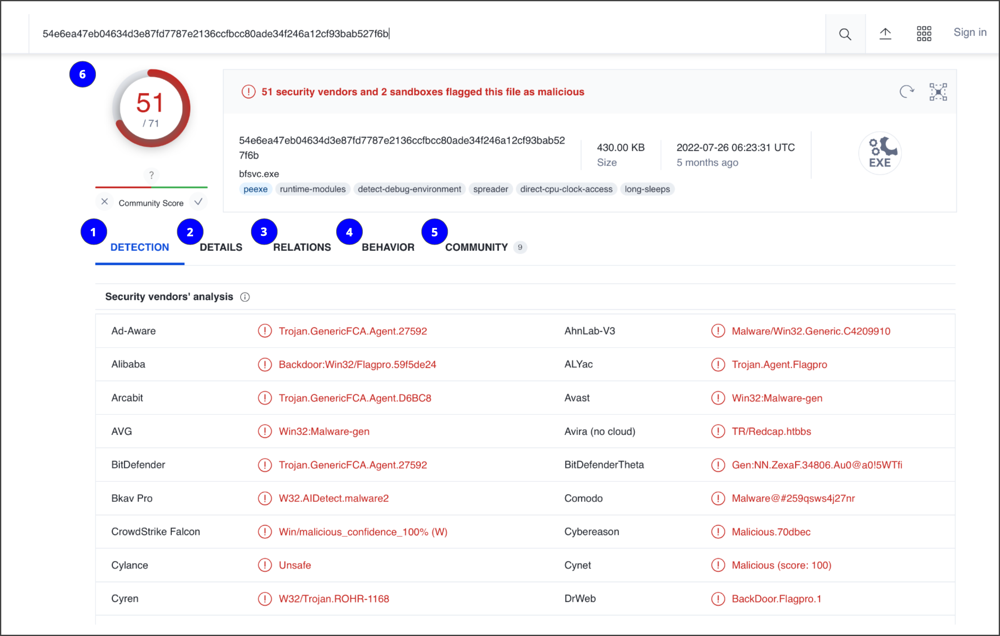

# Adding Context to Investigations

## 1. Adding Context to IoCs
- **IoC (Indicator of Compromise):** Observable evidence suggesting a potential security incident.
- A single IoC, such as a malicious IP address, may not provide enough information to understand an attack.
- Attackers can change IP addresses or other indicators to evade detection.
- **Threat intelligence** provides evidence-based information about existing or emerging threats and adds context to IoCs.
- Combining multiple pieces of evidence helps analysts understand the bigger picture and respond effectively.

**Example:** A suspicious IP address becomes more meaningful when linked to unusual network communications, suspicious processes, or malicious files.

## 2. Crowdsourcing
- **Definition:** Gathering information through public input and collaboration.
- In cybersecurity, crowdsourcing allows organizations and professionals to share threat intelligence.
- Helps organizations learn from attacks experienced by others.
- Improves detection methods and helps prevent similar attacks across multiple organizations.

### Sources of Shared Threat Intelligence
- Cybersecurity product vendors.
- Government agencies.
- Cloud service providers.
- Cybersecurity researchers and professionals.

**Information Sharing and Analysis Centers (ISACs):**
- Organizations that collect and share sector-specific threat intelligence.
- Examples of sectors include healthcare and energy.

**OSINT (Open-Source Intelligence):**
- The collection and analysis of information from publicly available sources.
- Used to investigate threat actors, threats, vulnerabilities, and attacks.

**Example:** An organization discovers a malicious file and shares its details through a threat intelligence service, helping other organizations detect the same threat.

## 3. [VirusTotal](https://www.virustotal.com/gui/home)
- **Definition:** An online service used to analyze suspicious files, file hashes, domains, URLs, and IP addresses.
- Helps determine whether an artifact may be malicious.
- Combines detection results from multiple security vendors.
- Provides information about relationships between IoCs and observed malicious behavior.

### VirusTotal Report Sections

1. **Detection**
   - Shows verdicts from different security vendors.
   - Verdicts may include malicious, suspicious, or harmless.

2. **Details**
   - Provides technical information about an artifact.
   - Includes file hashes, file type, file size, headers, creation time, and submission history.

3. **Relations**
   - Shows related IoCs connected to an artifact.
   - Examples include contacted URLs, domains, IP addresses, and dropped files.

4. **Behavior**
   - Shows observed activity in a controlled or sandboxed environment.
   - Includes processes, network communications, file system actions, registry changes, and detected attack techniques.

5. **Community**
   - Contains comments and insights shared by security professionals and researchers.

6. **Vendors' Ratio and Community Score**
   - **Vendors' ratio:** Indicates how many security vendors flag an artifact as malicious.
   - **Community score:** Reflects community input about the artifact.
   - Higher detection counts and positive malicious reports can increase suspicion, but neither score alone proves that an artifact is malicious.

**Important Security Note:** Data submitted to VirusTotal may be shared with the security community. Never upload confidential files, passwords, personal information, or sensitive organizational data without authorization.

## 4. Other IoC Investigation Tools

### A. Jotti's Malware Scan
- Free service that scans suspicious files using multiple antivirus engines.
- Has limitations on the number of files that can be submitted.
- Website: https://virusscan.jotti.org/

### B. URLscan.io
- Scans and analyzes URLs.
- Provides detailed reports about websites and their associated activity.
- Website: https://urlscan.io/

### C. MalwareBazaar
- A repository of malware samples.
- Provides malware-related information useful for threat intelligence and security research.
- Website: https://bazaar.abuse.ch/browse/

## 5. Key Takeaways
- Adding context to IoCs helps analysts understand attacks beyond individual indicators.
- Crowdsourcing enables organizations to share threat intelligence and defend against common attacks.
- ISACs share threat intelligence within specific industries.
- OSINT uses publicly available information to generate intelligence.
- VirusTotal analyzes files and other artifacts using multiple security vendors and provides related information.
- Jotti scans files, URLscan.io analyzes URLs, and MalwareBazaar provides malware samples.
- Multiple sources of evidence should be examined before deciding whether an artifact is malicious.
- Always consider data privacy before uploading artifacts to public investigation tools.

## 6. Resources

1. **VirusTotal:** https://www.virustotal.com/gui/home
2. **Jotti's Malware Scan:** https://virusscan.jotti.org/
3. **URLscan.io:** https://urlscan.io/
4. **MalwareBazaar:** https://bazaar.abuse.ch/browse/