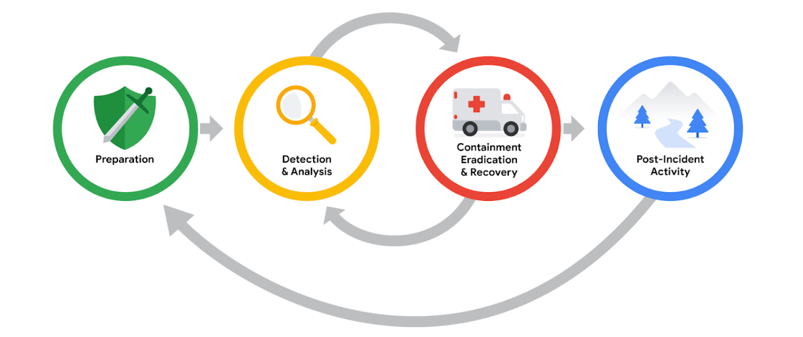

# Post-Incident Activity

- **Post-incident activity:** The final phase of the NIST Incident Response Lifecycle. It reviews an incident to identify improvements in incident handling.
- **Purpose:** Learn from incidents, improve response procedures, and prevent similar incidents in the future.

## Lessons Learned Meeting (Post-Mortem)

A meeting held after an incident has been resolved to evaluate the incident and identify improvements.

- **When:** Ideally, no later than two weeks after successful remediation.
- **Who:** All parties involved in the incident response process.
- **Purpose:** Improve processes, not assign blame.

### Questions Discussed
- What happened?
- When did it happen?
- Who discovered it?
- How was it contained?
- What recovery actions were taken?
- What could have been done differently?

### Meeting Preparation
- **Agenda:** Lists topics for discussion.
- **Moderator:** Leads and facilitates the meeting.
- **Scribe:** Records meeting notes.

### Recommendations
Lessons learned meetings can identify:
- Errors in response actions.
- Gaps in processes and procedures.
- Ineffective security controls.

The outcome should be a **prioritized list of actionable recommendations**, such as updating incident response playbooks or implementing new security tools.

## Final Report

A **final report** provides a comprehensive review of an incident. Its format may vary depending on the organization and intended audience.

### Common Elements
1. **Executive Summary:** High-level overview of key findings and essential facts.
2. **Timeline:** Chronological sequence of events with timestamps.
3. **Investigation:** Details of detection, analysis, and actions taken during the incident.
4. **Recommendations:** Suggested actions to prevent future incidents.

### The 5 W's of Incident Investigation
- **Who:** Who was involved?
- **What:** What happened?
- **Where:** Where did it happen?
- **Why:** Why did it happen?
- **When:** When did it happen?

**Important:** Final reports should be tailored to their audience. Executives and non-technical readers need clear explanations of the incident's impact and key findings without unnecessary technical jargon.

## Key Takeaways

- Post-incident activity helps organizations learn from security incidents.
- Lessons learned meetings identify improvements and produce actionable recommendations.
- Final reports document the incident, timeline, investigation, and future preventive measures.
- The goal is continuous improvement of incident response and the organization's overall security posture.