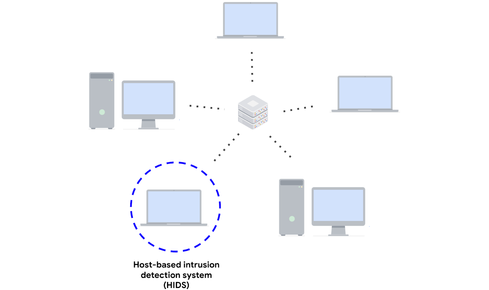
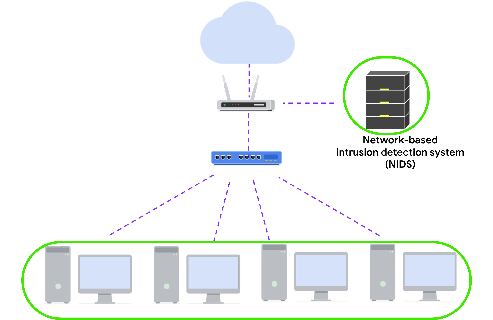

# Intrusion Detection Systems (IDS)

**Intrusion Detection System (IDS):** An application that monitors system or network activity and generates alerts when potential intrusions or malicious activities are detected.

IDS technologies help organizations identify suspicious activity and security threats.

There are two main types of IDS:

## 1. Host-Based Intrusion Detection System (HIDS)

- Monitors the activity of the individual host on which it is installed.
- Installed as an agent on an endpoint.
- **Endpoint:** Any device connected to a network, such as a computer or server.
- Detects unauthorized or abnormal activities occurring within the host.
- Generates logs and alerts when suspicious activity is detected.

### What HIDS Monitors
- Inbound and outbound traffic.
- File system activity.
- System resource usage.
- User activity.
- Unauthorized application installations.

**Example:** Detecting an unauthorized application installed on a computer.

## 2. Network-Based Intrusion Detection System (NIDS)

- Monitors network traffic and network data.
- Installed at specific points within a network.
- Inspects traffic coming from multiple devices.
- Generates logs and alerts when malicious network traffic is detected.

**Example:** Detecting suspicious network traffic originating from a computer connected to the organization's network.

### HIDS vs NIDS

| HIDS | NIDS |
|---|---|
| Monitors individual hosts/endpoints. | Monitors network traffic. |
| Installed on individual devices. | Installed at specific network locations. |
| Monitors internal host activity. | Monitors traffic across multiple devices. |
| Detects suspicious activities on a host. | Detects suspicious network activities. |

**Important:** Using both HIDS and NIDS provides a multi-layered approach to intrusion detection and gives security teams a more comprehensive view of their environment.

## Detection Techniques

IDS technologies commonly use two detection techniques:

1. Signature-Based Analysis
2. Anomaly-Based Analysis

## 3. Signature-Based Analysis

**Signature-Based Analysis:** A detection method that identifies threats by comparing system or network activity against known malicious patterns.

- **Signature:** A pattern associated with malicious activity.
- Signatures can contain binary sequences, bytes, IP addresses, or malicious code patterns.
- IoCs and IoAs can be used to create signatures for detecting attacks.
- Example: An anti-malware signature contains patterns associated with known malware.

When an event matches a stored signature, the IDS logs the event and generates an alert.

### Advantages
- **Low false positive rate:** Efficient at detecting known threats because activity is compared against specific known patterns.

### Disadvantages
- **Can be evaded:** Attackers can modify malware or attack patterns to bypass existing signatures.
- **Requires regular updates:** New signatures must be added whenever new threats or exploits are discovered.
- **Cannot detect unknown threats:** Struggles to identify zero-day attacks and previously unknown malware.

**False Positive:** An alert that incorrectly identifies normal activity as a threat.

**Zero-Day Attack:** An attack exploiting a previously unknown vulnerability.

## 4. Anomaly-Based Analysis

**Anomaly-Based Analysis:** A detection method that identifies abnormal behavior by comparing current activity against a baseline of normal behavior.

It works in two phases:

1. **Training Phase:**
   - Collects data about normal system behavior.
   - Establishes a baseline of expected activity.

2. **Detection Phase:**
   - Compares current activity against the established baseline.
   - Activity that deviates from the baseline is logged and generates an alert.

### Advantages
- **Detects unknown threats:** Can identify new and evolving threats that do not have existing signatures.

### Disadvantages
- **High false positive rate:** Legitimate activities that deviate from normal behavior can also trigger alerts.
- **Pre-existing compromise:** If an attacker is already present during the training phase, their malicious activity may become part of the normal baseline and go undetected.

## Signature-Based vs Anomaly-Based Analysis

| Signature-Based | Anomaly-Based |
|---|---|
| Detects known malicious patterns. | Detects deviations from normal behavior. |
| Uses a database of signatures. | Uses a baseline of normal activity. |
| Better at detecting known threats. | Can detect unknown threats. |
| Generally has fewer false positives. | Generally has more false positives. |
| Requires regular signature updates. | Requires accurate baseline training. |
| Can miss zero-day attacks. | Can detect previously unknown attacks. |

## Key Takeaways

- **HIDS:** Monitors individual endpoints.
- **NIDS:** Monitors network traffic.
- Using both provides multi-layered security monitoring.
- **Signature-based analysis:** Detects known threats using predefined patterns.
- **Anomaly-based analysis:** Detects unusual activity by comparing it against normal behavior.
- Signature-based detection has fewer false positives but struggles with unknown threats.
- Anomaly-based detection can identify unknown threats but may generate more false positives.