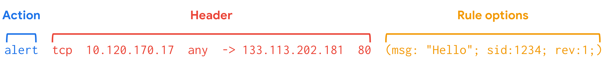

# Suricata IDS

## Introduction to Suricata

**Suricata** is an open-source tool that functions as an:
- Intrusion Detection System (IDS)
- Intrusion Prevention System (IPS)
- Network Security Monitoring (NSM) tool

## 1. Suricata Features

### IDS (Intrusion Detection System)
- Monitors network traffic and detects suspicious activities or intrusions.
- Can also work as a HIDS to monitor the system and network activities of an individual host.
- Generates alerts when suspicious activity is detected.

### IPS (Intrusion Prevention System)
- Detects and blocks malicious network traffic.
- Requires additional configuration to enable IPS mode.

### NSM (Network Security Monitoring)
- Monitors network activity and generates relevant network logs.
- Can analyze live network traffic and existing packet capture (PCAP) files.
- Can create and save full or conditional packet captures.
- Useful for digital forensics, incident response, and testing detection signatures.

## 2. Suricata Rules (Signatures)

- **Rules or Signatures:** Patterns used to identify suspicious network traffic, behaviors, and conditions.
- Suricata uses signature-based analysis to detect malicious activity.
- Rules can also provide additional visibility into networks and help identify security threats.

### Three Components of a Suricata Signature

1. **Action:** Defines what happens when traffic matches a rule.
   - `alert`: Generate an alert.
   - `pass`: Allow the traffic without further inspection by matching rules.
   - `drop`: Drop the matching packet.
   - `reject`: Block the traffic and send a rejection response.

2. **Header:** Contains network traffic information:
   - Source IP address
   - Source port
   - Destination IP address
   - Destination port
   - Protocol
   - Traffic direction

3. **Rule Options:** Provide additional conditions and settings to customize signatures.

**Important:** Rule options have a specific order. Changing their order can change the meaning of a rule.

**Example space:**

### Rule Processing Order

- Suricata evaluates rules according to its configured processing logic.
- Its default action order is:
  1. Pass
  2. Drop
  3. Reject
  4. Alert
- Rule processing order can affect the final verdict when multiple rules match the same packet.

## 3. Custom Rules

- Suricata provides pre-written rules, but organizations should customize them according to their security requirements.
- Every organization's IT infrastructure is different, so rules must be tested and modified accordingly.

### Benefits of Custom Rules
- Tailor detection to specific environments.
- Improve threat detection and network monitoring.
- Reduce false positive alerts.
- Improve security visibility and detection capabilities.

## 4. Configuration File

- **Configuration File:** A file used to define and customize an application's settings.
- Configuration determines how an IDS interacts with the organization's environment.
- Suricata uses a configuration file named **suricata.yaml**.
- It uses YAML syntax and structure.

## 5. Suricata Log Files

Suricata generates two important log files when events and alerts occur.

### A. eve.json
- Standard Suricata log file.
- Stores detailed event and alert information in JSON format.
- Contains additional metadata about network activity.
- Includes a unique identifier called **flow_id**.
- `flow_id` helps correlate related logs and alerts belonging to the same network flow.
- Suitable for detailed analysis, incident response, threat hunting, and SIEM log ingestion.

### B. fast.log
- Records basic alert information.
- Contains minimal details, such as source and destination IP addresses and port numbers.
- Used for basic logging and alert monitoring.
- Considered a legacy format.
- Not suitable for detailed incident response or threat hunting.

### eve.json vs fast.log

| eve.json | fast.log |
|---|---|
| Detailed logging | Basic logging |
| JSON format | Simple text format |
| Contains additional metadata | Contains minimal alert details |
| Includes flow_id | Does not provide the same detailed metadata |
| Useful for investigations and threat hunting | Useful for basic alert monitoring |
| Better for SIEM ingestion | Limited investigation capabilities |

## Key Takeaways

- Suricata can function as an IDS, IPS, and NSM tool.
- IDS detects suspicious activity, while IPS can detect and block malicious traffic.
- Suricata rules consist of Action, Header, and Rule Options.
- Custom rules improve detection and reduce false positives.
- `suricata.yaml` is the main configuration file.
- `eve.json` provides detailed logs, whereas `fast.log` provides basic alert information.

## Resources

- [Suricata User Guide](https://suricata.readthedocs.io/en/latest/index.html#)
- [Suricata Features](https://suricata.io/features/)
- [Rule Management](https://suricata.readthedocs.io/en/latest/rule-management/suricata-update.html)
- [Rule Performance Analysis](https://suricata.readthedocs.io/en/latest/configuration/suricata-yaml.html#engine-analysis-and-profiling)
- [Suricata Threat Hunting Webinar](https://youtu.be/kaDGolhTu94)
- [Introduction to Writing Suricata Rules](https://youtu.be/tvoqFBVSShA)
- [eve.json jq Examples](https://suricata.readthedocs.io/en/latest/output/eve/eve-json-examplesjq.html)